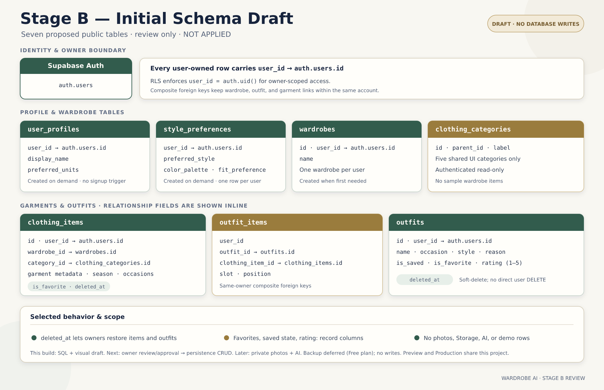

# Database

**Status:** Stage B initial-schema draft prepared for owner review; it has **not** been applied. No application migration or database write has occurred.
**Last updated:** 2026-10-23

## Platform and ownership model

Use Supabase Auth and PostgreSQL for the MVP. Supabase Auth owns credentials and authenticated identities; application rows reference the auth UUID. Row Level Security (RLS) is required for every user-owned table. Never rely on a client-supplied `user_id` as authorization.

Store image bytes in private Supabase Storage, not database rows. Stage C will separately design object keys, media metadata, private access, replacement, and cleanup. No Storage changes are part of the current draft.

## Inventory and safety boundary

Stage A created no application tables, migrations, or Storage objects. Read-only inventory performed on 2026-10-20 found no app-owned tables or columns in `public`; the broader non-system relation listing contained only Supabase-managed `auth`, `extensions`, `realtime`, `storage`, and `vault` relations. No row data or Vault secret contents were queried.

The existing Supabase project is shared by Vercel Preview and Production. The owner selected it conditionally for Stage B. The owner reports that the Supabase Free plan does not provide the desired backup option and has deferred that step for now; **no restorable backup/export has been created or verified**. There have been no DDL or data writes. Backup deferral is not approval to apply SQL.

## Initial schema draft

The exact additive draft is [`STAGE_B_INITIAL_SCHEMA_DRAFT.sql`](STAGE_B_INITIAL_SCHEMA_DRAFT.sql). It is a documentation artifact, not an executable migration, and has not been run against Supabase.

The draft contains only these initial tables:

- `user_profiles` and `style_preferences`: one owner-scoped row per user, created on demand; no Auth signup trigger.
- `wardrobes`: one owner-scoped wardrobe container per user, created when first needed.
- `clothing_categories`: shared, static category names used by the UI; authenticated read-only access.
- `clothing_items`: owner/wardrobe/category references and editable garment metadata.
- `outfits`: owner-scoped outfit metadata.
- `outfit_items`: outfit-to-garment links with same-owner composite foreign keys.

The draft seeds only the five static clothing categories (tops, bottoms, shoes, outerwear, accessories). It does not seed demo wardrobe, profile, or outfit records. New accounts remain empty until the user adds data.

### Owner-selected initial behavior

- Clothing items and outfits use recoverable deletion via `deleted_at`. Normal lists must exclude deleted rows; restoring sets `deleted_at` back to `NULL`. Soft-deleted items retain their outfit links so a restored item can reappear in those outfits.
- Favorite/save/rating state is stored on records: `clothing_items.is_favorite`, and `outfits.is_favorite`, `outfits.is_saved`, and nullable `outfits.rating` (1–5). There are no separate favorite/rating tables in this draft.
- Account deletion remains a hard cascade from the Supabase Auth user to the user's database rows. Storage cleanup belongs to the later, separately approved Stage C.

### Security and integrity in the draft

- RLS is enabled for every owner table. Owner policies compare the row's `user_id` with `auth.uid()` for reads and writes.
- The draft revokes `PUBLIC`, `anon`, and `authenticated` table grants, then grants owner-scoped privileges as needed to `authenticated`; the shared category catalogue is authenticated read-only. It does not alter table-owner/service-role privileges. Authenticated users have no direct hard-delete privilege on clothing items or outfits; those records are retired/restored through `deleted_at`.
- Composite foreign keys prevent wardrobe, outfit, and garment links from crossing account ownership.
- No client-supplied owner identity is trusted. Service-role usage, Storage access, and AI/provider flows are outside this draft.

## Backup, review, and rollout gates

1. **Backup status:** deferred by the owner because of the Free plan. No restorable backup/restore path has been verified. If the owner later obtains one, record its date and restore procedure; do not send credentials or dumps in chat.
2. **Exact SQL review:** the owner reviews [`STAGE_B_INITIAL_SCHEMA_DRAFT.sql`](STAGE_B_INITIAL_SCHEMA_DRAFT.sql) and explicitly approves that exact text or requests revisions. No approval has been given yet.
3. **Apply:** backup deferral alone is not permission to execute. A database write requires a separate explicit apply instruction after reconfirming that no restorable backup is available and the exact SQL is approved.
4. Before broader rollout, test anonymous access and at least two synthetic authenticated users, cross-user relationship rejection, create/update/soft-delete/restore flows, and account cleanup behavior.

Stage C private photos/Storage, real AI, payments, and Production setting changes are not included.
